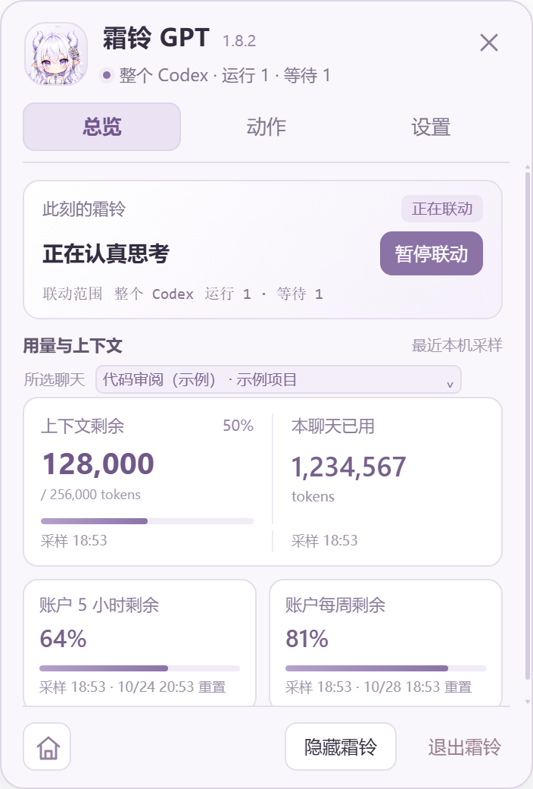
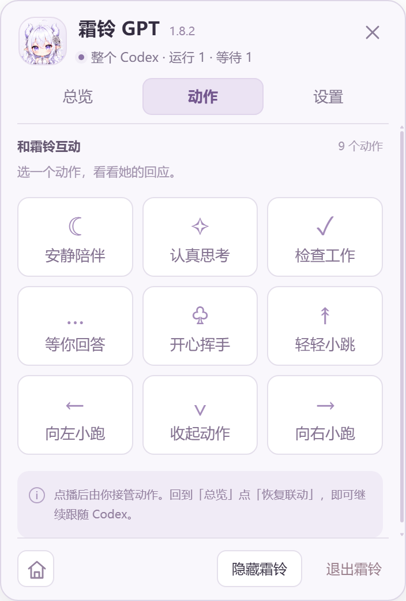
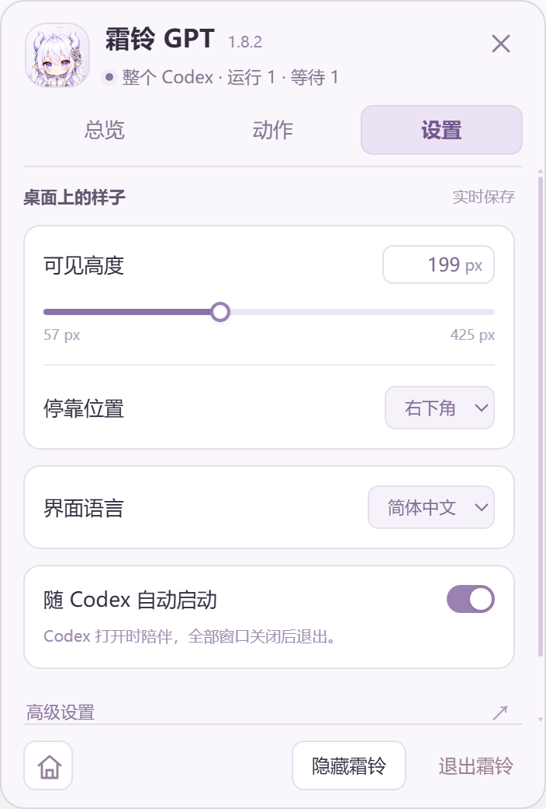

# 霜鈴 GPT · Shuangling GPT

[简体中文](../../README.md) · **繁體中文** · [English](README.en.md)

陪伴你使用 Codex 的銀髮 Q 版龍女桌寵。霜鈴顯示在 Windows 桌面上，跟隨本機 Codex 的工作狀態，並透過小型控制面板提供動作、聊天用量與帳戶額度資訊。

**版本：**1.8.2 · **平台：**Windows x64 · **整合方式：**本機 Codex 外掛程式 + MCP

## 效果預覽

### 動畫展示

<table>
  <tr><th>常態陪伴</th><th>開心揮手</th><th>認真思考</th></tr>
  <tr>
    <td><a href="../media/shuangling-demo.gif"></a></td>
    <td><a href="../media/shuangling-wave.gif"></a></td>
    <td><a href="../media/shuangling-thinking.gif"></a></td>
  </tr>
</table>

三個預覽分別循環播放目前版本的既有動畫，保留原動作節奏，僅做裁切、背景合成與 GIF 轉換；點擊可查看原尺寸動圖。

### 右鍵控制面板

<table>
  <tr><th>總覽</th><th>動作</th><th>設定</th></tr>
  <tr>
    <td><a href="../media/panel-overview.png"></a></td>
    <td><a href="../media/panel-actions.png"></a></td>
    <td><a href="../media/panel-settings.png"></a></td>
  </tr>
</table>

截圖來自實際面板程式碼，以簡體中文介面搭配展示聊天與用量；點擊圖片可查看清晰原圖。面板支援簡體中文、繁體中文與 English。[素材來源與預覽說明](../media/README.md)

## 功能

- 九種角色動畫、透明視窗、拖曳、拋擲與螢幕邊緣停靠。
- 霜白淡紫右鍵控制面板，包含**總覽、動作、設定**三頁。
- 開啟 Codex 主視窗後自動啟動；所有主視窗關閉持續三秒後退出。
- 彙整目前本機 Codex 工作階段中已觀測的根聊天狀態。
- 顯示用量區所選聊天的剩餘上下文與累計 token。
- 獨立讀取目前登入帳戶的共用額度，不受聊天選擇影響。
- 無須 API Key，不發起額外模型請求。

## 快速開始 · 安裝外掛程式

需要 **Windows 10/11 x64 與已安裝的 Codex 桌面應用程式**。免安裝包包含 Node、Electron、已建置的桌寵宿主、視窗觀察器及執行依賴，不必安裝 Node/npm 或自行編譯。目前採用本機外掛程式安裝，並非官方商店項目；不支援 macOS、Linux 或 Windows ARM。

1. 下載 **[Windows x64 免安裝包](https://github.com/lemon7500/shuangling-gpt/releases/download/v1.8.2/shuangling-gpt-1.8.2-windows-x64.zip)**（`shuangling-gpt-1.8.2-windows-x64.zip`）。[查看 Release 與附件](https://github.com/lemon7500/shuangling-gpt/releases/tag/v1.8.2)。GitHub 的 **Source code** 壓縮檔不是免安裝包。
2. **完整解壓縮**至固定、目前使用者可寫入的資料夾。不要直接在 ZIP 中執行；路徑可包含中文或空格，安裝後請保留此目錄。
3. 按兩下解壓後根目錄的 **`安装Codex插件.vbs`**，再確認 Codex 外掛程式清單中的 **霜铃 GPT** 已啟用。安裝範圍為目前 Windows 使用者，不需管理員身分；若本機原則阻止登錄登入工作，仍可手動啟動霜鈴。
4. **完整關閉所有 Codex 視窗後重新開啟**，無須傳送訊息或呼叫外掛程式工具。按右鍵開啟霜鈴面板，在**總覽**選擇本機聊天，並於**設定**調整**隨 Codex 自動啟動**。

安裝器會依解壓目錄重建本機路徑，註冊 `shuangling-gpt@shuangling-local`，並依偏好管理目前使用者的登入觀察工作。包內 MCP 範本預設停用，執行安裝入口後才會註冊本機路徑，請勿直接安裝範本。搬移目錄後，請於新位置重新執行安裝器。詳見[外掛程式安裝說明](../../plugin-marketplace/README.md)。

登入 Windows 時只執行輕量觀察器，開啟 Codex 才會顯示桌寵。最小化不影響執行，多個 Codex 視窗共用一隻。手動退出後，本次 Codex 工作階段不會自動重新開啟；完整關閉再開啟 Codex，或明確手動啟動霜鈴，才會解除抑制。

也可按兩下 **`启动霜铃.vbs`** 獨立陪伴；工作狀態與帳戶用量需要本機 Codex 提供資料。尚未選擇聊天或資料不可讀時，用量保持未知。

包內首讀請見[免安裝包使用說明（三語）](../PORTABLE.md)，保留設定、搬移及排查請見[安裝、遷移與移除](../INSTALL.md)。

<details>
<summary>開發者：從原始碼準備執行環境</summary>

```powershell
git clone https://github.com/lemon7500/shuangling-gpt.git
cd shuangling-gpt
powershell -NoProfile -ExecutionPolicy Bypass -File .\setup.ps1
```

若使用原始碼 ZIP，請在解壓目錄執行最後一行。準備程式會下載並驗證 Node 與 Electron、安裝鎖定依賴、建置宿主並編譯觀察器；不會安裝外掛程式或啟動桌寵。完成後再使用根目錄安裝入口；可加上 `-Plan` 先查看準備內容。免安裝包使用者無須執行此步驟。

</details>

## 日常操作

| 操作 | 效果 |
|---|---|
| 拖曳／拋擲 | 移動霜鈴；透明區域允許點擊下方應用程式。 |
| 按右鍵 | 開啟固定大小的控制卡片，不縮放桌寵視窗。 |
| 總覽 | 查看工作狀態、選擇用量聊天、暫停或恢復聯動。 |
| 動作 | 點播九種動作。使用者操作優先；使用**恢復聯動**交回控制。 |
| 設定 | 調整可見高度、停靠位置、介面語言及自動啟動。 |
| Esc／點擊外部／右上角關閉 | 關閉面板。 |
| 底部按鈕 | 回到初始位置、隱藏霜鈴或退出。 |

另有手動入口：**`启动霜铃.vbs`**、**`霜铃设置.vbs`**、**`退出霜铃.vbs`**。

在面板「設定 → 介面語言」或進階設定中選擇 **简体中文／繁體中文／English**，會保留目前聊天選擇、動畫、位置及其他偏好。

## 工作狀態、token 與帳戶額度

三種資訊採用不同來源：

| 顯示內容 | 範圍 |
|---|---|
| 工作動畫 | 目前本機 Codex 工作階段中已觀測的根聊天。任何聊天工作時維持工作狀態；子代理不會獨立觸發完成。 |
| 上下文與累計 token | 用量區選取的單一聊天，不合併同專案其他聊天。 |
| 五小時／每週額度 | 目前登入的帳戶。切換用量聊天不改變此來源。 |

上下文是所選聊天最近一次模型請求的取樣，不是尚未送出文字的即時精確用量。較舊但有效的取樣會標記為歷史資料；累計記錄不完整時，可能以 **≥** 顯示已確認的下限。

帳戶額度透過本機 Codex 原生帳戶介面取得。認證版本改變時，服務會清除舊資料，並拒絕前一帳戶延遲回傳的結果，平常每 30 秒更新。依實際回報的時間長度辨識額度：帳戶確實提供五小時視窗時才顯示；Pro 或 Max 明確僅提供每週視窗時，隱藏五小時卡片。資料缺失、過期或斷線時顯示未知，不自行填成零或滿額。

目前 Pro 的實機讀取及聊天切換隔離已驗證。Plus／Pro／Max 切換邏輯通過自動化測試，真實 Plus／Max 登入切換尚未實測。

目前 Codex 未提供可可靠辨識「畫面正開啟哪個聊天」的公開介面，因此用量聊天需手動選取；這個選擇不影響整體工作聯動。

## 隱私與限制

- 工作適配器讀取本機根聊天事件，不保存或傳送對話正文、不建立模型任務；一般執行不改寫 Codex 設定。
- 視窗觀察器只檢查 Codex 套件身分與主視窗，不讀取對話。
- 認證由 Codex 原生用戶端處理；面板結果及保存的用量報告不包含帳戶識別碼、電子郵件或憑證。
- 本機日誌屬內部格式，可能隨更新改變。無法讀取或格式不相容時顯示未知，仍保留拖曳與陪伴功能。
- 不把日誌沉默視為完成，也不把單一工具失敗視為整項工作失敗；不保證精確辨識審批等待或整項工作錯誤。
- 目前素材仍有袖口細節、局部穿模及工作板遮嘴等瑕疵，未宣稱已重畫原素材中缺少的姿勢。
- 安裝此 Windows 外掛程式，不會自動將角色匯入獨立的 Pets 服務。

## 開發

專案使用 ES Modules。先完成 `setup.ps1`，再於專案根目錄使用已準備的 Node 執行測試，不必另外安裝全域 Node 或 npm：

```powershell
.\windows\runtime\node\node.exe --test --test-concurrency=4 tests/bridge/*.test.mjs tests/plugin/*.test.mjs tests/lifecycle/*.test.mjs tests/panel/*.test.mjs
```

準備程式會安裝 `vendor/dsh-pet` 的鎖定依賴，並建置獨立宿主與桌面共用核心。連動語意及本機介面詳見 [BRIDGE.md](../../BRIDGE.md)。請勿公開本機設定、執行時驗證檔案或對話日誌。

## 停用與解除安裝

在設定關閉**隨 Codex 自動啟動**可停用自動啟動。在 Codex 外掛程式清單停用或解除安裝 **霜铃 GPT**，會停止後續自動拉起並停用登入工作。已執行的聯動實例會在 Codex 所有主視窗關閉後退出；需要立即停止時可使用**退出霜鈴**。解除安裝不會刪除專案目錄或本機設定。

## 參考與署名

- **桌寵執行環境參考：**[PC2005-cloud/dsh-pet](https://github.com/PC2005-cloud/dsh-pet)，固定提交為 `d7a308ecd4504cf4468c03707ce228ed1e1c0402`。本專案沿用其視窗、物理互動、獨立模式及本機動畫介面；保留上游 MIT 授權與第三方聲明，詳見 [UPSTREAM.md](../../UPSTREAM.md)。
- **初始參考圖原作者：**B 站 [@ZipZipPipe](https://space.bilibili.com/4168597)。該作者創作了使用者最初提供的參考圖；霜鈴的 Q 版形象與桌寵動畫由本專案在此基礎上改編，透過 AI 輔助製作與本機處理完成。

程式碼授權不代表取得參考原畫或角色設計的權利；相關權利歸各權利人所有。署名不代表原作者背書，亦不額外授予素材再散布許可。
